# Итоговая работа: развёртывание и мониторинг audit-svc

**Вариант 2: GitHub Actions.** Был выбран этот вариант, так как у только сервера 3.8 ГБ памяти и 1 vCPU, а GitLab и Harbor из варианта 1 требуют около 8 ГБ. Тесты и сборка выполняются на облачных раннерах GitHub, развёртывание — на self-hosted runner `devops-vm` на целевой машине.

| | |
|---|---|
| Пайплайн | [`.github/workflows/ci.yml`](.github/workflows/ci.yml) |
| Реестр | `ghcr.io/vladimir011838/audit-svc` |
| Развёртывание | Ansible: [`deploy/audit-svc.play.yml`](deploy/audit-svc.play.yml) |
| Мониторинг | [`monitoring/`](monitoring) |

## Схема

```
push в main     → Tests → Build and publish image (main_<sha>)
тег vX.Y.Z      → Tests → Build and publish image (vX.Y.Z) → Deploy (self-hosted, environment production)

Deploy (Ansible на devops-vm):
  сеть audit-net, том audit-pgdata, PostgreSQL 17 (без портов)
  → пользователь audit_svc и БД audit (владелец audit_svc)
  → config.yaml из шаблона  ──notify──┐
  → migrate (★) до обновления сервиса  │
  → контейнер audit-svc (без портов)   │
  → flush_handlers: POST /reload ◄─────┘
  → /healthz → Nginx (127.0.0.1:8088) и nginx-exporter (127.0.0.1:9113)
```

---

## 1. Сборка и публикация образа

**[`Dockerfile`](Dockerfile)** — многоступенчатая сборка: стадия `build` (Poetry 2 + `poetry-plugin-export`, колёса зависимостей, колесо сервиса) и финальная стадия. Колёса устанавливаются через `RUN --mount=type=bind,from=build`, без лишнего слоя с `dist`. Процесс работает от пользователя `app` (UID/GID 10001). `CMD ["server"]`, поэтому `docker run образ migrate` и `docker run образ generate` запускают нужные скрипты.

**[`.dockerignore`](.dockerignore)** — белый список: в контекст попадают только `pyproject.toml`, `poetry.lock`, `README.md` и `src/`.

**Воспроизводимая сборка.** Без неё новый тег давал бы новый образ, и `docker_container` пересоздавал бы контейнер:
- `SOURCE_DATE_EPOCH` — дата **последнего коммита, менявшего код сервиса** (`git log -1 --format=%ct -- src pyproject.toml poetry.lock README.md Dockerfile .dockerignore`), а не последнего коммита. Коммит, который меняет только `vault.yml`, даёт тот же образ;
- при заданном `SOURCE_DATE_EPOCH` Poetry собирает колесо с фиксированными датами, а pip компилирует `.pyc` без меток времени;
- `rewrite-timestamp=true` выставляет одинаковое время всем файлам в слоях;
- `provenance: false`, `sbom: false` и никаких меток `org.opencontainers.image.revision`: они меняются от сборки к сборке.

Подтверждение: при релизах `v1.0.0`, `v1.0.1` и `v1.0.3` задача `audit-svc container` дала `ok`, и контейнер, запущенный в 11:03:03, не перезапускался (раздел 3).

Пайплайн ветки по умолчанию: тесты (`poetry run pytest --junitxml`, отчёт выгружается артефактом `junit-report` при любом исходе), сборка, публикация с тегом `main_<короткий sha>`. Логин в реестр — `GITHUB_TOKEN` с `permissions: packages: write`, в файле и в логе его нет.

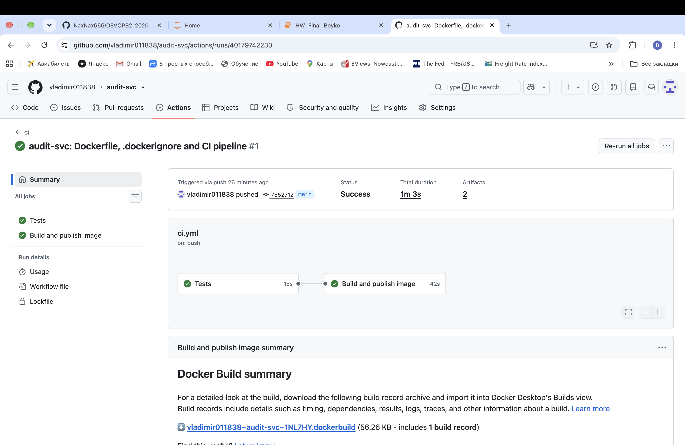

Лог публикации:

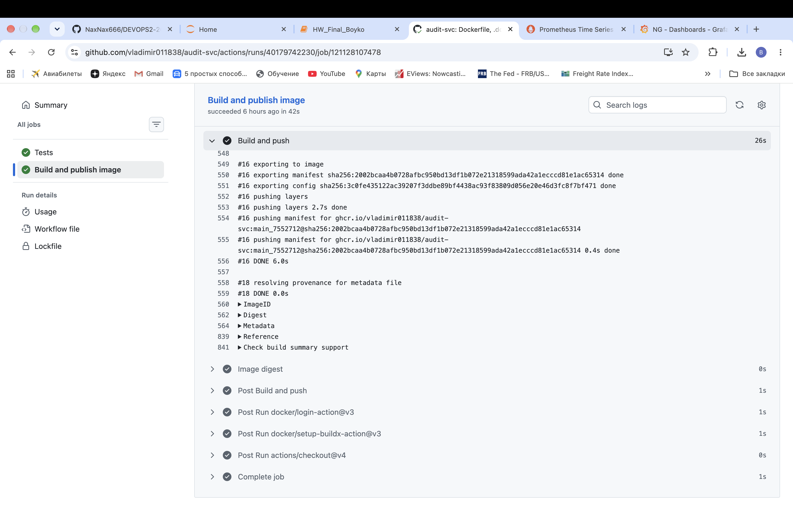

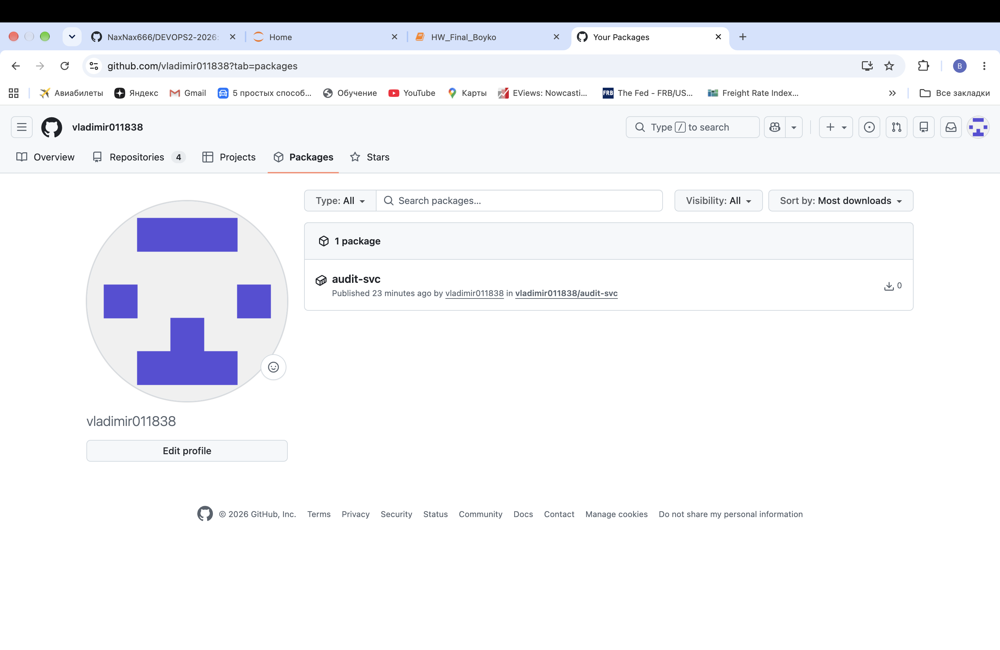

## 2. База данных и секреты

- **PostgreSQL**: контейнер `postgres:17`, данные в томе `audit-pgdata`, порт **не публикуется**. Ansible работает на той же машине и подключается по IP контейнера в docker-сети `audit-net`.
- **БД и пользователь** создаются задачами `community.postgresql.postgresql_user` и `postgresql_db`: БД `audit`, владелец `audit_svc`.
- **Секреты**: пароль суперпользователя и пароль `audit_svc` лежат в [`deploy/inventories/prom/group_vars/all/vault.yml`](deploy/inventories/prom/group_vars/all/vault.yml), файл зашифрован `ansible-vault` (`$ANSIBLE_VAULT;1.1;AES256`). У задач с паролями стоит `no_log: true`.
- **Ключ ansible-vault** — секрет `ANSIBLE_VAULT_PASSWORD` окружения `production`, которое пускает только теги `v*`. Ansible получает ключ через `--vault-password-file vault-pass.sh`: скрипт печатает переменную окружения в CI, а локально читает файл `vault-pass` из `.gitignore`.

```
$ docker exec audit-postgres psql -U postgres -c '\l audit' -c '\du audit_svc'
 Name  |   Owner   | Encoding | ...
-------+-----------+----------+
 audit | audit_svc | UTF8     |

 Role name | Attributes
-----------+------------
 audit_svc |
```

Окружение `production` не пустило тег, пока правило было задано не для тегов, и секрет задаче не выдало:

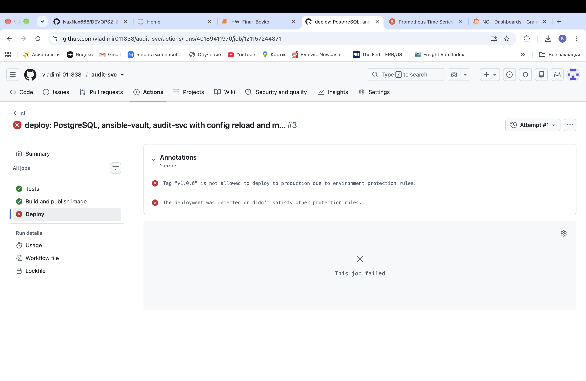

Защищённые теги — ruleset `release-tags` для `v*` (создание, изменение, удаление, force push запрещены, в bypass только администратор):

```
$ git push origin v1.0.0
remote: Bypassed rule violations for refs/tags/v1.0.0:
remote: - Cannot create ref due to creations being restricted.
 * [new tag]         v1.0.0 -> v1.0.0
```

## 3. Развёртывание из CI

- **Задача `deploy`** запускается только на теге (`if: github.ref_type == 'tag'`) после публикации образа, на раннере `[self-hosted, deploy]`, в окружении `production` с URL `http://localhost:8088`. Образ — тег этого релиза (`-e audit_svc_tag=${{ github.ref_name }}`).
- **Конфиг из шаблона**: `templates/config.yaml.j2` → `/data/audit-svc/config/config.yaml`, права `0640`, группа `audit-svc` (GID 10001, как у `app` в образе): `-rw-r----- ghrunner audit-svc`. В контейнер монтируется **каталог**, а не файл: `template` подменяет файл новым inode, и смонтированный отдельно файл показывал бы старое содержимое.
- **Перечитывание вместо перезапуска**: хендлер `Reload audit-svc config` вызывает `POST /reload` напрямую по IP контейнера (через Nginx `/reload` закрыт). `meta: flush_handlers` перед проверкой `/healthz` и `force_handlers: true`.
- **Закреплённые версии коллекций** ([`deploy/requirements.yml`](deploy/requirements.yml)): `community.docker 3.13.3`, `community.postgresql 3.9.0`. Плюс явный `image_name_mismatch: ignore`: в community.docker 4.x значение по умолчанию станет `recreate`, и контейнер пересоздавался бы при смене тега даже с тем же ID образа (об этом предупреждал лог релиза `v1.0.0`).

Пайплайн защищённого тега:

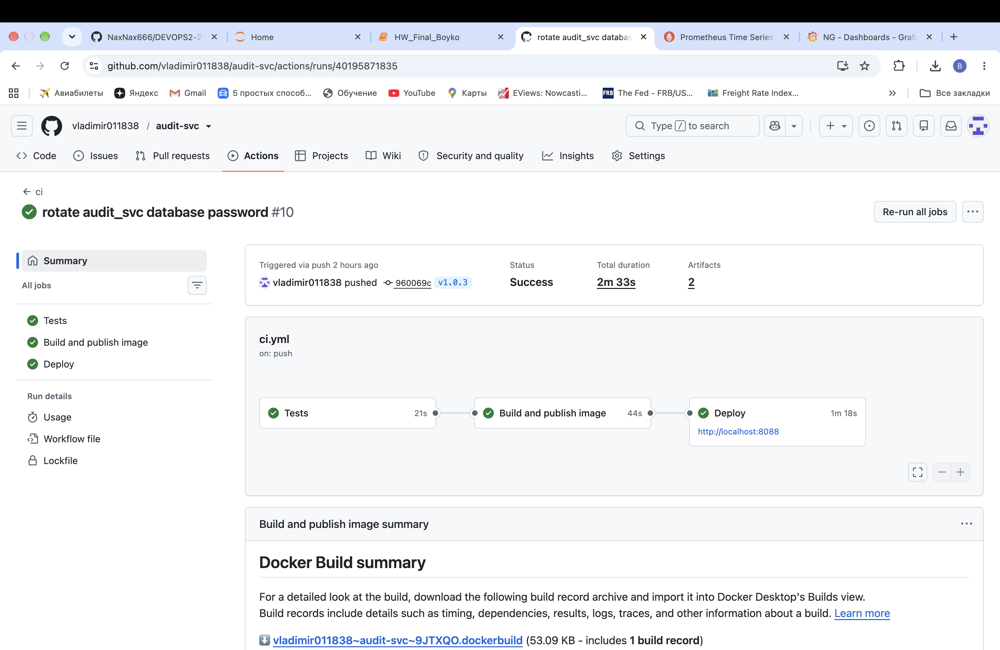

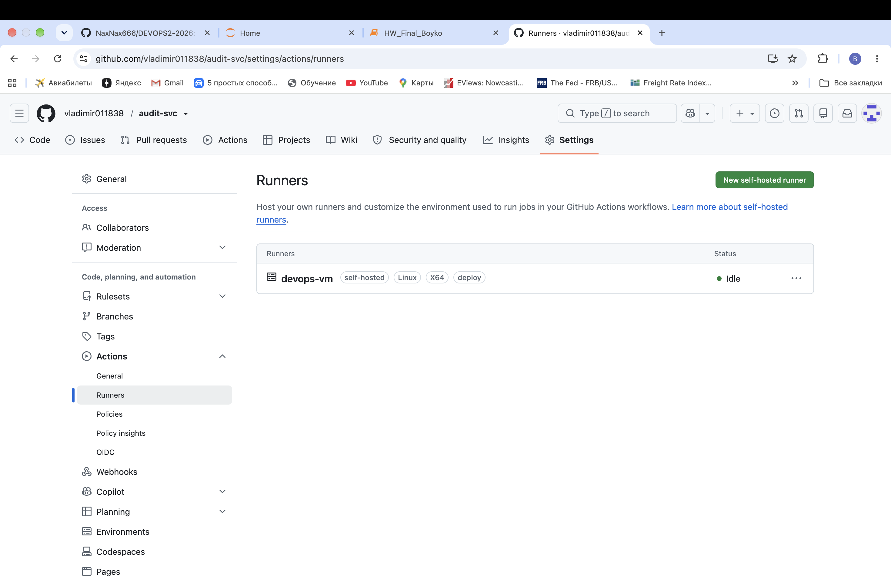

Повторный запуск задачи развёртывания без изменений: `changed=0`, хендлеры не срабатывают:

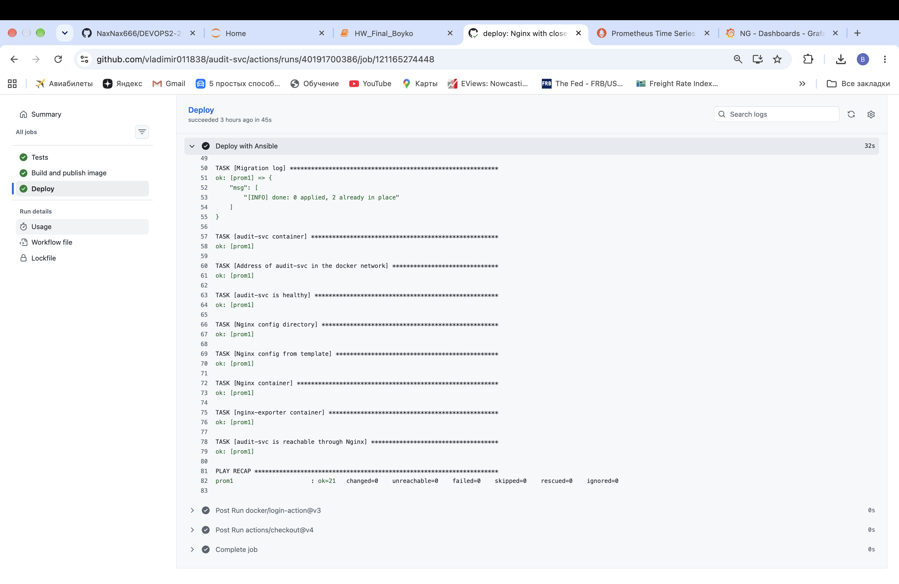

### Смена пароля

**1. До:**

```
$ docker inspect -f '{{.State.StartedAt}}' audit-svc
2026-10-25T11:03:03.660377325Z
$ curl -s localhost:8088/metrics | grep '^audit_config_reloads_total'
audit_config_reloads_total{result="success"} 2.0
$ docker logs audit-svc 2>&1 | grep -c 'reconnected to the database'
1
```

**2.** Новый пароль `audit_svc` через `ansible-vault edit`, коммит `960069c rotate audit_svc database password`, тег `v1.0.3`.

**3. Лог развёртывания `v1.0.3`:**

```
TASK [Database user audit_svc] *************************************************
changed: [prom1]
TASK [Service config from template] ********************************************
changed: [prom1]
TASK [Pull image of the release] ***********************************************
changed: [prom1]
TASK [Database migrations] *****************************************************
ok: [prom1]
TASK [Migration log] ***********************************************************
ok: [prom1] => {"msg": ["[INFO] done: 0 applied, 2 already in place"]}
TASK [audit-svc container] *****************************************************
ok: [prom1]
TASK [Apply config reload before health check] *********************************
RUNNING HANDLER [Reload audit-svc config] **************************************
ok: [prom1]
RUNNING HANDLER [Reload result] ************************************************
ok: [prom1] => {"msg": {"changed": true, "status": "reloaded"}}
TASK [audit-svc is healthy] ****************************************************
ok: [prom1]
...
PLAY RECAP *********************************************************************
prom1                      : ok=23   changed=3    unreachable=0    failed=0    skipped=0    rescued=0    ignored=0
```

**4. После:**

```
$ docker inspect -f '{{.State.StartedAt}}' audit-svc
2026-10-25T11:03:03.660377325Z
$ docker logs audit-svc 2>&1 | grep 'config reload' | tail -n 3
2026-10-25 11:03:12,150 [INFO] audit_svc.main: config reloaded, database settings are unchanged
2026-10-25 12:37:59,809 [INFO] audit_svc.main: config reloaded, reconnected to the database
2026-10-25 13:05:47,443 [INFO] audit_svc.main: config reloaded, reconnected to the database
$ curl -s localhost:8088/metrics | grep '^audit_config_reloads_total'
audit_config_reloads_total{result="success"} 3.0
$ curl -s -w '  (HTTP %{http_code})\n' localhost:8088/healthz
{"status": "ok"}  (HTTP 200)
```

`StartedAt` не изменился, сервис переподключился с новым паролем, счётчик вырос с 2 до 3, `/healthz` отвечает 200.

**Найденная ошибка.** Первая попытка смены пароля (тег `v1.0.2`) упала: проверка `/healthz` шла до хендлера, а хендлеры Ansible выполняются в конце плея. Сервис ещё работал со старым паролем и отвечал 503, плей упал, и хендлер не выполнился. Сервис был восстановлен ручным `POST /reload` по IP контейнера (строка 12:37:59 выше). В плейбук добавлены `meta: flush_handlers` перед проверкой и `force_handlers: true`, после чего смена пароля прошла на `v1.0.3`.

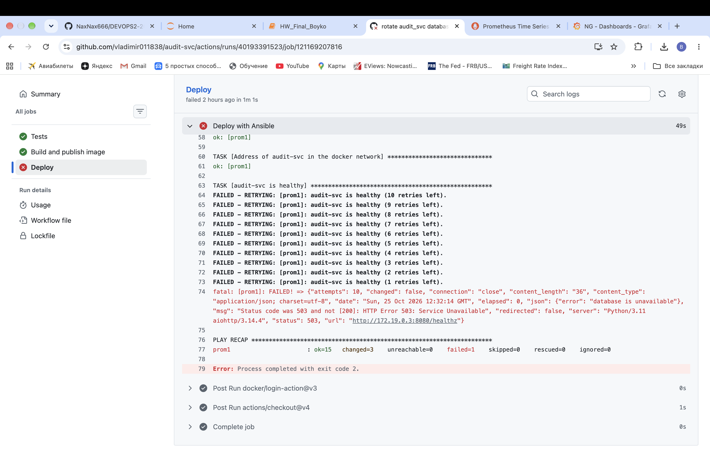

## 4. Nginx и nginx-exporter

[`deploy/templates/nginx.conf.j2`](deploy/templates/nginx.conf.j2):
- `location = /reload { return 404; }`: Nginx сравнивает location с нормализованным путём (`%72` → `r`, `//` → `/`, без `?x=1`), поэтому все варианты записи попадают сюда;
- `resolver 127.0.0.11 valid=10s` и `proxy_pass` через переменную: имя сервиса резолвится заново, и после пересоздания контейнера (новый IP) нет 502;
- `stub_status` — на отдельном порту 8081, который не публикуется.

```
$ curl -s localhost:8088/healthz
{"status": "ok"}
$ curl -s -o /dev/null -w '%{http_code}\n' -X POST localhost:8088/reload
404
$ curl -s -o /dev/null -w '%{http_code}\n' -X POST 'localhost:8088/reload?x=1'
404
$ curl -s -o /dev/null -w '%{http_code}\n' -X POST localhost:8088//reload
404
$ curl -s -o /dev/null -w '%{http_code}\n' -X POST localhost:8088/%72eload
404
$ docker logs audit-svc 2>&1 | grep -c 'config reload'
1
$ curl -s localhost:9113/metrics | grep '^nginx_up'
nginx_up 1
$ curl -s -o /dev/null -w 'stub_status на основном порту: %{http_code}\n' localhost:8088/stub_status
stub_status на основном порту: 404
$ docker ps --format '{{.Names}}\t{{.Ports}}'
audit-nginx-exporter    127.0.0.1:9113->9113/tcp
audit-nginx     80/tcp, 127.0.0.1:8088->8080/tcp
audit-svc       8080/tcp
audit-postgres  5432/tcp
```

Число строк `config reload` не изменилось после запросов: до сервиса они не дошли. Порты опубликованы только у Nginx и exporter (`80/tcp` у Nginx — `EXPOSE` образа, без публикации).

## 5. Мониторинг

[`monitoring/compose.yaml`](monitoring/compose.yaml): Prometheus и Grafana подключены к сети развёртывания `audit-net` как к внешней. Метрики сервиса собираются **через Nginx** (`audit-nginx:8080/metrics`), метрики Nginx — с `audit-nginx-exporter:9113`. Источник данных Grafana создаётся из provisioning. Нагрузка: `generate --url http://audit-nginx:8080 --duration 900` в сети `audit-net`.

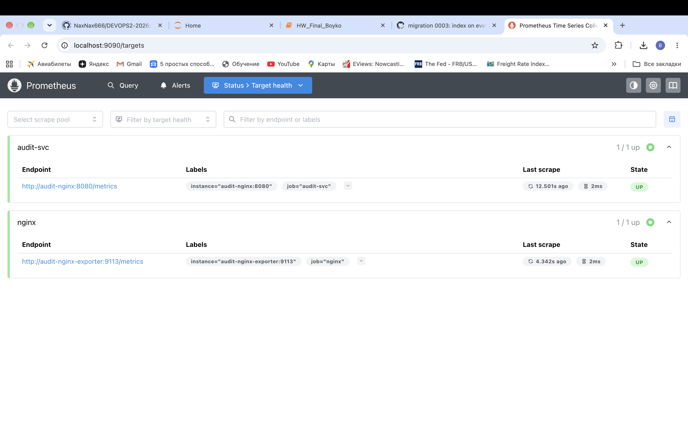

Дашборд сервиса ([`monitoring/grafana/audit-svc.json`](monitoring/grafana/audit-svc.json)):

| Панель | Запрос |
|---|---|
| События в секунду | `sum by (app) (rate(audit_events_received_total[$__rate_interval]))` |
| Коды ответов, % | `100 * sum by (code) (rate(audit_http_requests_total[$__rate_interval])) / ignoring(code) group_left sum(rate(audit_http_requests_total[$__rate_interval]))`, стек, 0–100 % |
| Сервис запущен | `up{job="audit-svc"}`, Stat: `1 → UP` (зелёный), `0 → DOWN` (красный) |


Панель «Сервис запущен» после `docker stop audit-svc` и после `docker start audit-svc`:

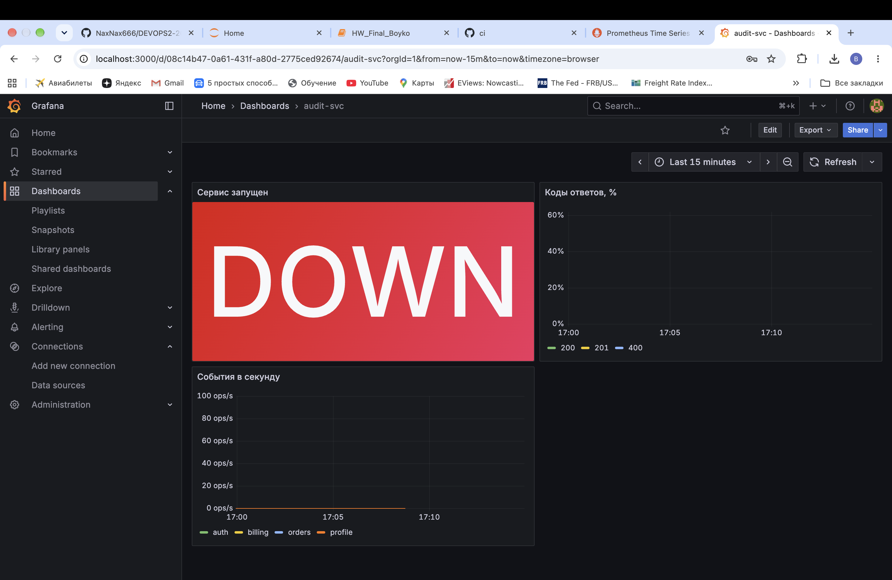

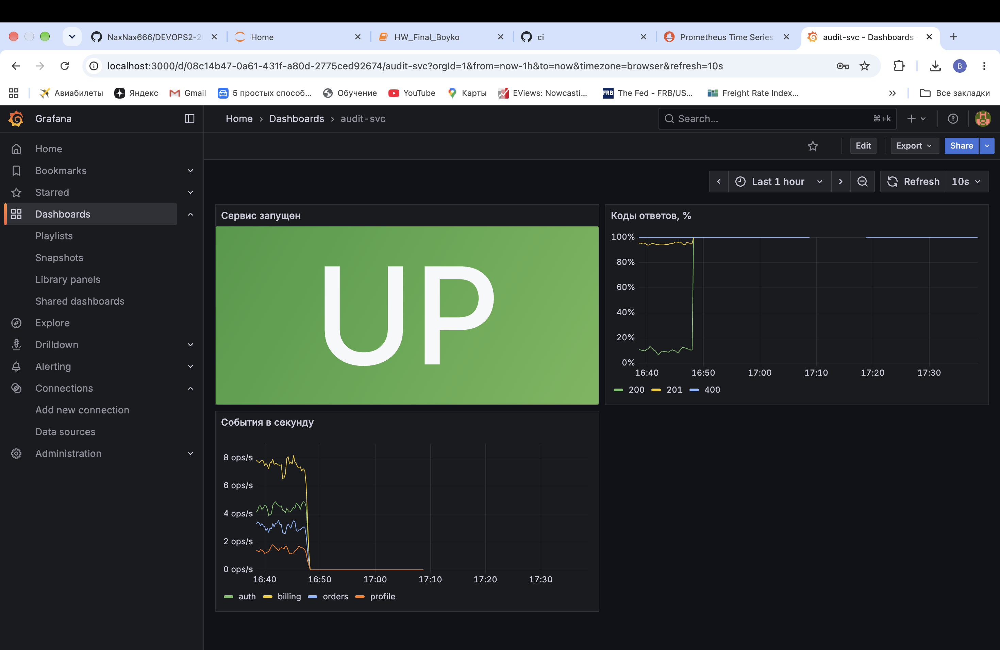

Импортированный дашборд Nginx ([`monitoring/grafana/nginx.json`](monitoring/grafana/nginx.json)):

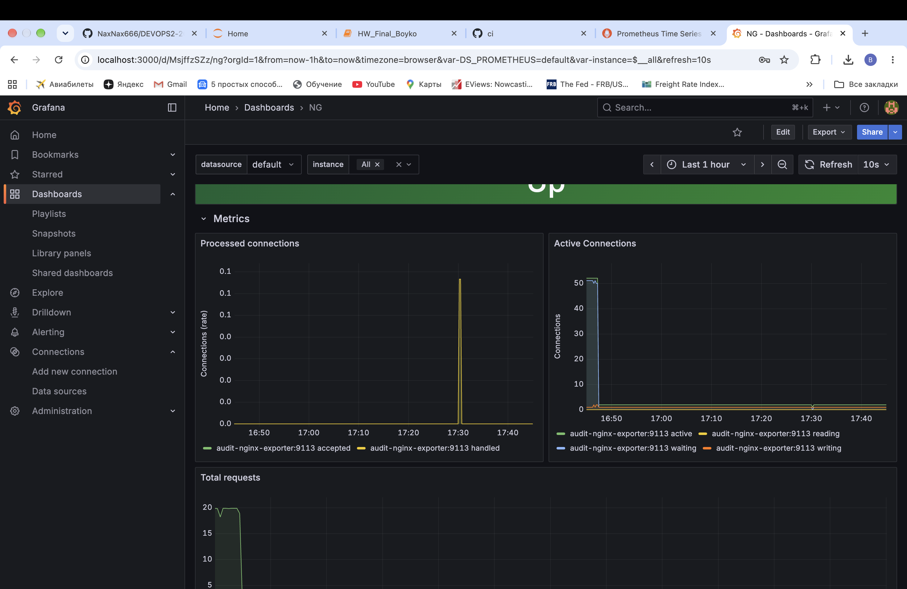

## ★ Миграции при каждом развёртывании

`migrate` запускается в одноразовом контейнере **до** задачи `audit-svc container` при каждом развёртывании. При ненулевом коде выхода плей останавливается, и новый образ не запускается. `changed` — только если в выводе есть `applying`, поэтому при той же схеме задача даёт `ok` с `done: 0 applied, 2 already in place`.

Проверка: миграция [`0003_events_actor_index.sql`](src/audit_svc/migrations/0003_events_actor_index.sql), тег `v1.1.0`:

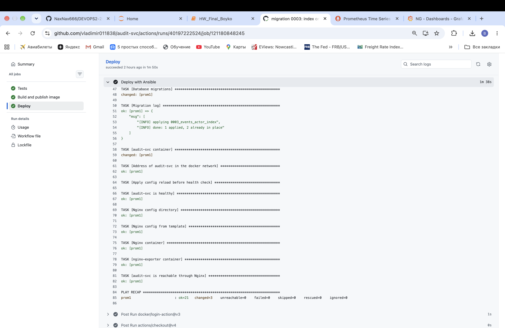

```
$ docker exec audit-postgres psql -U postgres -d audit -c 'SELECT version, applied_at FROM schema_migrations ORDER BY version'
         version         |          applied_at
-------------------------+-------------------------------
 0001_create_events      | 2026-10-25 11:02:24.601725+00
 0002_events_app_index   | 2026-10-25 11:02:24.606476+00
 0003_events_actor_index | 2026-10-25 13:23:50.578253+00
```

Миграция применена в 13:23:50, новый контейнер сервиса запущен в 13:24:13 — после неё. Это первый релиз с изменением кода, поэтому контейнер пересоздан ожидаемо, а `/healthz` через Nginx сразу ответил 200.
